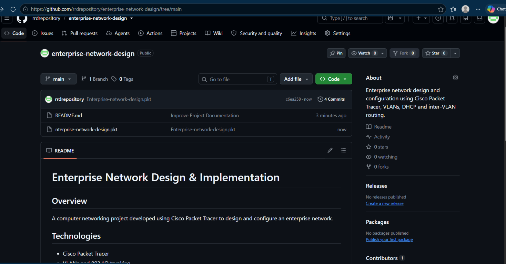

# Enterprise Network Design & Implementation

## Overview
A computer networking project developed using Cisco Packet Tracer to design and configure an enterprise network.

## Network Topology

## Technologies
- Cisco Packet Tracer
- VLANs and 802.1Q trunking
- Router-on-a-Stick inter-VLAN routing
- DHCPv4
- Static routing

## Objectives
- Segment network devices into separate VLANs.
- Enable communication between VLANs.
- Configure automatic IP address allocation using DHCP.
- Configure routing between networks.
- Test network connectivity.

## Project File
- `Completed (2).pkt` — Cisco Packet Tracer network simulation.

## Testing
Add screenshots and describe the connectivity tests you performed, such as successful pings between devices in different VLANs.

## Learning Outcomes
- Practised network segmentation and IP addressing.
- Gained experience configuring routing and DHCP.
- Developed troubleshooting skills using Cisco Packet Tracer.
