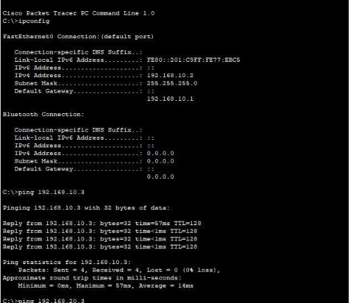
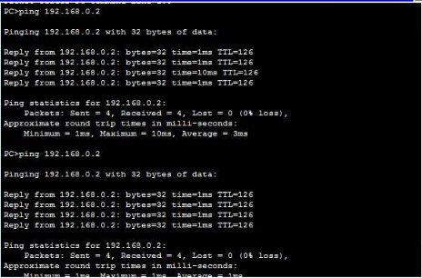

# Enterprise Network Design & Implementation

## Overview
A computer networking project developed using Cisco Packet Tracer to design and configure an enterprise network.

## Network Topology

## Testing & Validation

Connectivity tests were performed using Cisco Packet Tracer's command prompt.
| Test                   | Destination    | Result               |
|------------------------|----------------|----------------------|
| PC1 to default gateway | `192.168.10.1` | Passed — 4/4 replies |
| PC1 to VLAN 20 gateway | `192.168.20.1` | Passed — 4/4 replies |
| PC1 to VLAN 30 gateway | `192.168.30.1` | Passed — 4/4 replies |
| PC1 to VLAN 99 gateway | `192.168.99.1` | Passed — 4/4 replies |
| PC1 to PC2             | `192.168.20.11`| Passed — 4/4 replies |
| PC1 to PC4             | `192.168.30.11`| Reachable — 3/4 replies on initial test |

### DHCP and Gateway Validation

### Inter-VLAN Connectivity

### DHCP Validation
PC1 successfully received IPv4 address `192.168.10.11` with subnet mask `255.255.255.0` and default gateway `192.168.10.1`.
R1's DHCP pool output also showed one leased address in each of the Staff, Student and Guest pools.

## Technologies
- Cisco Packet Tracer
- VLANs and 802.1Q trunking
- Router-on-a-Stick inter-VLAN routing
- DHCPv4
- Static routing

## Objectives
- Segment network devices into separate VLANs.
- Enable communication between VLANs.
- Configure automatic IP address allocation using DHCP.
- Configure routing between networks.
- Test network connectivity.

## Project File
- `Completed (2).pkt` — Cisco Packet Tracer network simulation.

## Testing
Add screenshots and describe the connectivity tests you performed, such as successful pings between devices in different VLANs.

## Learning Outcomes
- Practised network segmentation and IP addressing.
- Gained experience configuring routing and DHCP.
- Developed troubleshooting skills using Cisco Packet Tracer.
